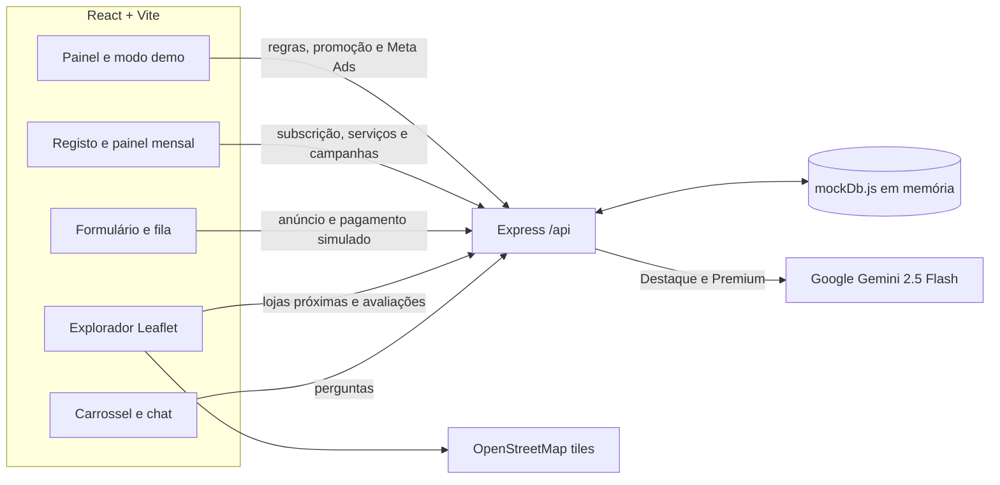

# Chimoio Boladas — protótipo MVP

Protótipo de apresentação com React/Vite, API Express, dados em memória, mapa OpenStreetMap/Leaflet e suporte PWA instalável. A interface usa azul e branco, com verde reservado para pequenos realces. Os pagamentos EscalePay são simulados; os planos Destaque e Premium usam a API real do Gemini quando a chave está configurada.

## Arranque local

Requer Node.js 20 ou superior e npm.

1. Configure a chave Gemini, se disponível:

   ```sh
   cp backend/.env.example backend/.env
   ```

   Edite `backend/.env` e substitua `GEMINI_API_KEY` por uma chave válida. Não partilhe nem faça commit do ficheiro `.env`. Sem chave, o resto da aplicação funciona; pedidos de IA em anúncios Destaque/Premium devolvem erro de configuração. O plano Básico responde localmente sem chamar o Gemini.

2. Em dois terminais, instale e inicie cada aplicação:

   ```sh
   cd backend
   npm install
   npm run dev
   ```

   ```sh
   cd frontend
   npm install
   npm run dev
   ```

3. Abra o endereço indicado pelo Vite (normalmente `http://localhost:5173`). A API está em `http://localhost:3001`; o Vite encaminha `/api` para ela.

Os registos, anúncios, avaliações e métricas vivem apenas na memória do processo e são repostos quando o backend reinicia. O GPS pede autorização do navegador; sem permissão, o mapa usa o centro de Chimoio (`-19.1164, 33.4833`). Os tiles do mapa são servidos pelo OpenStreetMap.

## Instalação PWA e modo offline

O frontend gera `manifest.webmanifest`, ícones instaláveis e service worker na build de produção. O service worker actualiza automaticamente, guarda a shell para abrir offline, tenta primeiro a API e usa dados GET guardados quando não há rede, e mantém em cache imagens e tiles de mapa já consultados. Chat e outras operações de escrita precisam de ligação e não são guardados offline.

```sh
cd frontend
npm run build
npm run preview
```

Abra o endereço local do preview e instale pelo botão do navegador (Chrome/Edge) ou por **Partilhar → Adicionar ao ecrã principal** no Safari do iOS. Em dispositivos publicados, a instalação PWA requer HTTPS. Para receber respostas da API e guardar dados durante o uso online, sirva frontend e backend sob a mesma origem ou configure um reverse proxy para `/api`.

Os lotes são isolados por plano (`basico`, `destaque` ou `premium`). Cada lote só recebe anúncios daquele plano; a publicação Web continua a ocorrer com 6 anúncios ou após 30 minutos. Meta Ads exige 6 anúncios do mesmo plano e receita mínima de 600 MT.

## Prestadores de serviços

Os prestadores têm um fluxo mensal separado dos anúncios avulsos e não entram nos lotes. A categoria Individual tem dois planos simulados:

| Plano | Preço mensal | Campanhas externas | Presença na plataforma |
| --- | ---: | ---: | --- |
| Básico | 1.000 MT | 2 por ciclo | Perfil e serviços após revisão administrativa |
| Premium | 1.500 MT | 4 por ciclo | Área Premium, destaque superior e prioridade nos resultados |

O Empresarial está indisponível. O registo simula um ciclo de 30 dias; não há cobrança recorrente real. O prestador pode renovar ou mudar de plano no painel, submeter serviços e consultar o estado. O Admin aprova o perfil, publica os serviços e regista cada campanha externa, respeitando a quota do ciclo. Os perfis só aparecem publicamente com subscrição activa, aprovados e com serviços publicados. O selector de contas continua a ser apenas uma simulação para apresentação: não existe autenticação e este protótipo não deve ser exposto como serviço de produção.

## Fluxo da arquitetura



## Rotas principais

| Método e rota | Função |
| --- | --- |
| `GET /api/state` | Estado inicial da apresentação e dos painéis |
| `POST /api/anuncios/criar-e-pagar` | Simula EscalePay, cria anúncio e o coloca num lote |
| `POST /api/lotes/verificar-regras` | Aplica publicação Web por 6 anúncios do mesmo plano ou 30 minutos; suporta modo de demonstração |
| `POST /api/lotes/:id/publicar-meta` | Liberta Meta Ads apenas com 6 anúncios do mesmo plano e pelo menos 600 MT |
| `POST /api/admin/promover` | Permite ao SupaAdmin promover um utilizador a Admin |
| `GET /api/lojas/proximas` | Filtra lojas por tipo/raio usando Haversine |
| `POST /api/lojas/:id/avaliar` | Regista uma avaliação única por cliente e loja |
| `POST /api/chat/perguntar` | Limita a 10 perguntas por dia e encaminha planos elegíveis ao Gemini |
| `POST /api/prestadores/registar` | Regista prestador, primeiro serviço pendente e pagamento mensal simulado |
| `POST /api/prestadores/:id/plano` | Muda/renova o plano por 30 dias e repõe a quota |
| `POST /api/prestadores/:id/servicos` | Envia serviço adicional para revisão administrativa |
| `POST /api/admin/prestadores/:id/aprovar` | Aprova perfil de prestador |
| `POST /api/admin/prestadores/:id/servicos/:listingId/publicar` | Publica serviço após aprovação e verificação da subscrição |
| `POST /api/admin/prestadores/:id/campanhas` | Regista campanha externa dentro da quota mensal |

O seletor de perfil é exclusivamente para a demonstração, não representa autenticação real. A ligação a anúncios Meta e a cobrança real também estão fora deste protótipo.
# chimoio-bolas
# chimoio-bolas
# chimoio-bolas
# chimoio-bolas
