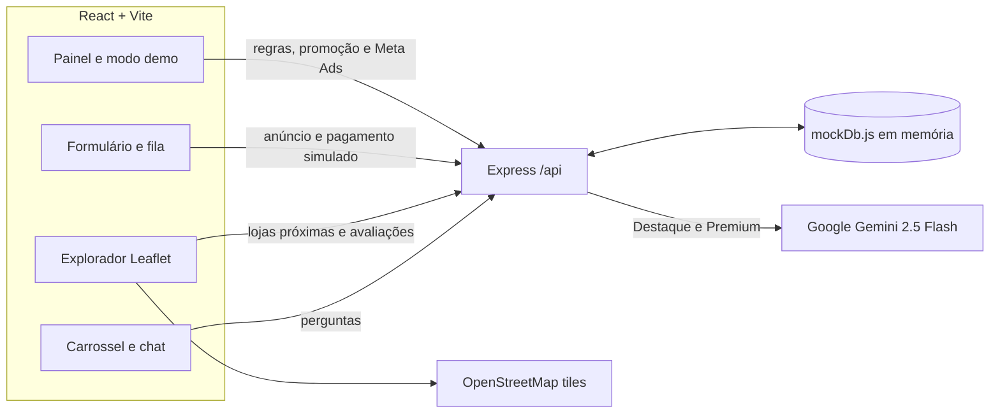

# Chimoio Boladas — protótipo MVP

Protótipo de apresentação com React/Vite, API Express, dados em memória e mapa OpenStreetMap/Leaflet. Os pagamentos EscalePay são simulados; os planos Destaque e Premium usam a API real do Gemini quando a chave está configurada.

## Arranque local

Requer Node.js 20 ou superior e npm.

1. Configure a chave Gemini, se disponível:

   ```sh
   cp backend/.env.example backend/.env
   ```

   Edite `backend/.env` e substitua `GEMINI_API_KEY` por uma chave válida. Não partilhe nem faça commit do ficheiro `.env`. Sem chave, o resto da aplicação funciona; pedidos de IA em anúncios Destaque/Premium devolvem erro de configuração. O plano Básico responde localmente sem chamar o Gemini.

2. Em dois terminais, instale e inicie cada aplicação:

   ```sh
   cd backend
   npm install
   npm run dev
   ```

   ```sh
   cd frontend
   npm install
   npm run dev
   ```

3. Abra o endereço indicado pelo Vite (normalmente `http://localhost:5173`). A API está em `http://localhost:3001`; o Vite encaminha `/api` para ela.

Os registos, anúncios, avaliações e métricas vivem apenas na memória do processo e são repostos quando o backend reinicia. O GPS pede autorização do navegador; sem permissão, o mapa usa o centro de Chimoio (`-19.1164, 33.4833`). Os tiles do mapa são servidos pelo OpenStreetMap.

## Fluxo da arquitetura



## Rotas principais

| Método e rota | Função |
| --- | --- |
| `GET /api/state` | Estado inicial da apresentação e dos painéis |
| `POST /api/anuncios/criar-e-pagar` | Simula EscalePay, cria anúncio e o coloca num lote |
| `POST /api/lotes/verificar-regras` | Aplica publicação Web por 6 anúncios ou 30 minutos; suporta modo de demonstração |
| `POST /api/lotes/:id/publicar-meta` | Liberta Meta Ads apenas com 6 anúncios e pelo menos 600 MT |
| `POST /api/admin/promover` | Permite ao SupaAdmin promover um utilizador a Admin |
| `GET /api/lojas/proximas` | Filtra lojas por tipo/raio usando Haversine |
| `POST /api/lojas/:id/avaliar` | Regista uma avaliação única por cliente e loja |
| `POST /api/chat/perguntar` | Limita a 10 perguntas por dia e encaminha planos elegíveis ao Gemini |

O seletor de perfil é exclusivamente para a demonstração, não representa autenticação real. A ligação a anúncios Meta e a cobrança real também estão fora deste protótipo.
# chimoio-bolas
